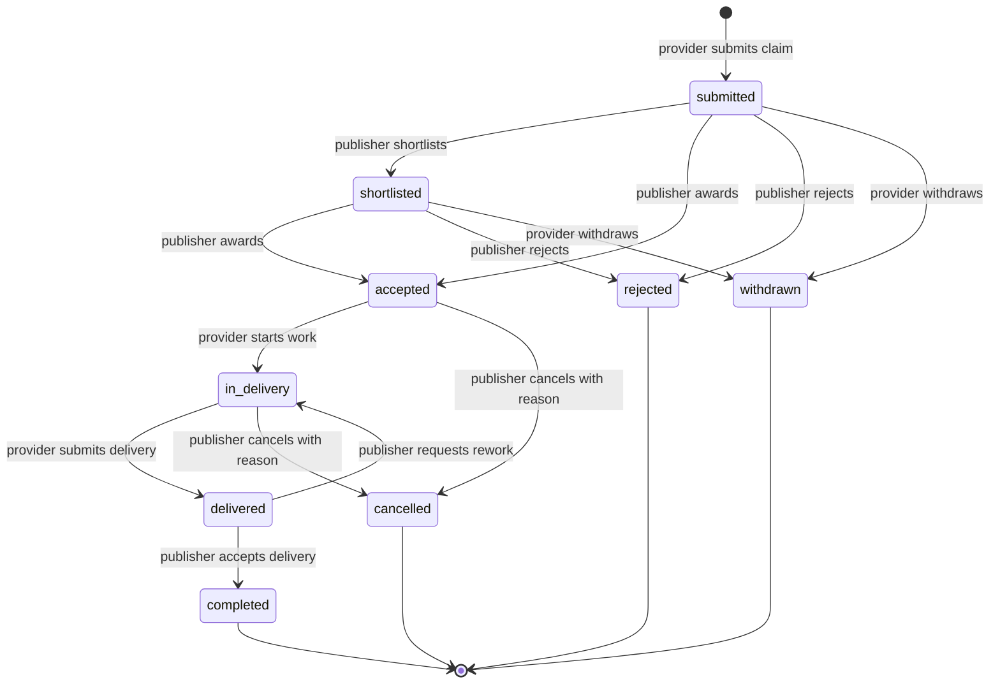

# Demand Claim (抢单) Lifecycle Spec

Status: active
Owner: SDKWork order capability
Application: order
Domain: commerce
Table prefix: `commerce_`
Last updated: 2026-11-02

## 1. Purpose

A **demand claim** (抢单) is a provider's binding offer to deliver a published demand. It is
the pre-order stage of the demand-delivery lifecycle: the provider quotes a price and a
delivery window, the publisher selects a claim, the provider delivers, and the publisher
accepts the delivery. The claim record, its status machine, and its event timeline are owned
by `sdkwork-order` because the claim is what the delivery order will be built from.

The demand itself (title, category, application form, budget, bid deadline, publisher
identity) remains owned by the company domain. The claim stores an immutable snapshot of the
demand facts it was submitted against, so a later demand edit never rewrites history.

## 2. Roles

| Role | Identity | Can do |
| --- | --- | --- |
| Provider (bidder) | `bidder_user_id` = authenticated subject | Create a claim, withdraw it, start delivery, submit delivery |
| Publisher (demand owner) | `publisher_user_id` = authenticated subject | Shortlist, accept (award), reject, request rework, accept delivery |
| Operator | backend API, `commerce.demand_claims.manage` | Inspect and advance any claim for support and dispute handling |

A publisher never claims their own demand: creation rejects `bidder_user_id ==
publisher_user_id`. One provider holds at most one claim per demand; the unique key
`(tenant_id, demand_id, bidder_user_id)` makes re-submission idempotent.

## 3. Lifecycle

### 3.1 Status vocabulary

| Status | UI label (zh-CN) | Group | Meaning |
| --- | --- | --- | --- |
| `submitted` | 抢单中 | `in_progress` | Waiting for the publisher to review |
| `shortlisted` | 已入围 | `in_progress` | Publisher marked it as a candidate |
| `accepted` | 待开工 | `in_progress` | Publisher awarded the claim; work has not started |
| `in_delivery` | 交付中 | `in_progress` | Provider is delivering |
| `delivered` | 待验收 | `in_progress` | Provider submitted the deliverable |
| `completed` | 已完成 | `completed` | Publisher accepted the delivery |
| `rejected` | 未通过 | `closed` | Publisher declined |
| `withdrawn` | 已撤回 | `closed` | Provider withdrew before award |
| `cancelled` | 已取消 | `closed` | Publisher cancelled after award |

The `My Claims` page groups these into **抢单中** (`in_progress`), **已完成**
(`completed`), **未通过/已关闭** (`closed`), and **全部**. Inside
**抢单中** the page exposes one status-level filter per stage — 待审核
(`submitted`), 已入围 (`shortlisted`), 待开工 (`accepted`), 交付中
(`in_delivery`), 待验收 (`delivered`) — so a provider can jump straight to the
stage that needs action. The group is derived from the status, never stored
twice.

### 3.2 Transition rules

Every transition is validated by the domain state machine and executed with a
`WHERE status = <expected>` guard, so concurrent or repeated requests cannot skip a step.
Every accepted transition appends one immutable `commerce_demand_claim_event` row carrying
the actor, the from/to status, the note, and the request id.

| Action | Endpoint | Actor | From → To |
| --- | --- | --- | --- |
| Submit | `POST /app/v3/api/orders/demand_claims` | provider | — → `submitted` |
| Shortlist | `POST .../{claimId}/shortlist` | publisher | `submitted` → `shortlisted` |
| Award | `POST .../{claimId}/accept` | publisher | `submitted`/`shortlisted` → `accepted` |
| Reject | `POST .../{claimId}/reject` | publisher | `submitted`/`shortlisted` → `rejected` |
| Withdraw | `POST .../{claimId}/withdraw` | provider | `submitted`/`shortlisted` → `withdrawn` |
| Start | `POST .../{claimId}/start` | provider | `accepted` → `in_delivery` |
| Deliver | `POST .../{claimId}/deliver` | provider | `in_delivery` → `delivered` |
| Accept delivery | `POST .../{claimId}/complete` | publisher | `delivered` → `completed` |
| Request rework | `POST .../{claimId}/rework` | publisher | `delivered` → `in_delivery` |
| Cancel | `POST .../{claimId}/cancel` | publisher | `accepted`/`in_delivery` → `cancelled` |

Awarding one claim does not automatically reject the others: the publisher rejects or leaves
them open explicitly, so a provider is never silently discarded.

## 4. Delivery lifecycle (demand → claim → order)

The full demand-delivery lifecycle spans two capabilities; this spec fixes the ownership
boundary so the product behaves consistently:

1. **Publish** — the company domain publishes the demand (budget, categories, bid deadline).
2. **Claim** — a provider submits a claim in the order domain with a demand snapshot,
   quote, delivery days, and proposal. This is the record the My Claims page reads.
3. **Review & award** — the publisher shortlists, awards, or rejects. Awarding freezes the
   agreed quote and delivery days on the claim, and the same transaction rejects every other
   still-open claim on that demand (`submitted`/`shortlisted` → `rejected`) with a timeline
   event, so losing providers see a closed outcome instead of a permanently pending claim.
   The app also mirrors the decision onto the company-domain bid (`accept`/`reject`), which
   moves the demand `published → assigned`; that is the projection the hall card reads.
4. **Delivery** — the provider starts and submits the deliverable. Delivery notes and
   attachment URLs are stored on the claim event payload.
5. **Acceptance** — the publisher accepts the delivery (`completed`) or requests rework.
   Completion stamps `completed_at`, closes the claim, and mirrors the terminal decision onto
   the company demand (`assigned → completed`).
6. **Order handoff (next phase)** — when payment or invoicing is involved, the awarded claim
   becomes the subject of a `commerce_order` (subject `demand_claim`). The claim keeps
   `order_id`/`order_no` for that handoff; the current phase leaves them null and settles
   nothing.

Terminal claims are immutable except for corrections performed by an operator through the
backend API.

## 5. Data model

### 5.1 `commerce_demand_claim`

| Column | Type | Notes |
| --- | --- | --- |
| `id` | TEXT PK | Snowflake id |
| `tenant_id` | TEXT | Tenant scope |
| `organization_id` | TEXT | Buyer organization scope, nullable |
| `claim_no` | TEXT | Human-readable claim number (`DC` + timestamp + short id) |
| `demand_id` | TEXT | Company-domain demand id |
| `demand_title` | TEXT | Snapshot |
| `demand_category` | TEXT | Snapshot |
| `demand_type` | TEXT | Company demand family snapshot: `development` / `purchase` / `design` / `other` / `video` / `image` / `music` / `voice`; order stores the token and does not close the list |
| `app_forms` | TEXT[] | Ordered application forms commissioned by the demand (canonical) |
| `app_form` | TEXT | Compatibility projection of the first `app_forms` element |
| `budget_text` / `budget_min` / `budget_max` | TEXT | Snapshot of the demand budget |
| `bid_deadline` | TIMESTAMPTZ | Snapshot of the demand bid deadline |
| `publisher_user_id` | TEXT | Demand owner (snapshot) |
| `publisher_company_name` | TEXT | Display only |
| `bidder_user_id` | TEXT | Authenticated provider |
| `bidder_company_id` | TEXT | Optional provider company |
| `quote_amount_minor` | NUMERIC(20,0) | Agreed price in canonical minor units (1 CNY = 100 minor), per the order money convention |
| `quote_currency` | TEXT | Default `CNY` |
| `delivery_days` | INT | Optional committed delivery days |
| `proposal` | TEXT | Implementation plan |
| `status` | TEXT | Status vocabulary above |
| `reject_reason` | TEXT | Publisher reason |
| `withdraw_reason` | TEXT | Provider reason |
| `cancel_reason` | TEXT | Publisher reason |
| `delivery_note` | TEXT | Latest delivery submission note |
| `delivery_attachment_urls` | TEXT | JSON array |
| `request_no` | TEXT | Client request id |
| `idempotency_key` | TEXT | Client retry key |
| `order_id` / `order_no` | TEXT | Future order handoff |
| `submitted_at` / `accepted_at` / `started_at` / `delivered_at` / `completed_at` / `closed_at` | TIMESTAMPTZ | Milestones |
| `created_at` / `updated_at` | TIMESTAMPTZ | Audit |

Indexes: `(tenant_id, bidder_user_id, status, updated_at DESC)` for My Claims,
`(tenant_id, publisher_user_id, status, updated_at DESC)` for the publisher inbox,
`(tenant_id, demand_id)` for demand claim counts, plus the unique key above.

### 5.2 `commerce_demand_claim_event`

Append-only timeline: `id`, `tenant_id`, `claim_id`, `event_no`, `event_type`,
`from_status`, `to_status`, `actor_type` (`provider`/`publisher`/`operator`/`system`),
`actor_id`, `message`, `payload_json`, `request_id`, `idempotency_key`, `created_at`.
Indexed by `(tenant_id, claim_id, created_at ASC)` and `(tenant_id, event_type, created_at DESC)`.

## 6. API surface (app)

| Method | Path | Operation |
| --- | --- | --- |
| POST | `/app/v3/api/orders/demand_claims` | Create claim |
| GET | `/app/v3/api/orders/demand_claims` | List my claims (`status`, `status_group`, `demand_id`, `role`, `page`, `page_size`) |
| GET | `/app/v3/api/orders/demand_claims/statistics` | Counts per status for My Claims tabs |
| GET | `/app/v3/api/orders/demand_claims/{claimId}` | Claim detail |
| GET | `/app/v3/api/orders/demand_claims/{claimId}/events` | Claim timeline |
| POST | `/app/v3/api/orders/demand_claims/{claimId}/withdraw` | Provider withdraws |
| POST | `/app/v3/api/orders/demand_claims/{claimId}/start` | Provider starts work |
| POST | `/app/v3/api/orders/demand_claims/{claimId}/deliver` | Provider submits delivery |
| POST | `/app/v3/api/orders/demand_claims/{claimId}/shortlist` | Publisher shortlists |
| POST | `/app/v3/api/orders/demand_claims/{claimId}/accept` | Publisher awards |
| POST | `/app/v3/api/orders/demand_claims/{claimId}/reject` | Publisher rejects |
| POST | `/app/v3/api/orders/demand_claims/{claimId}/complete` | Publisher accepts delivery |
| POST | `/app/v3/api/orders/demand_claims/{claimId}/rework` | Publisher requests rework |
| POST | `/app/v3/api/orders/demand_claims/{claimId}/cancel` | Publisher cancels |

Action endpoints take an optional `{ "note": "..." }` body; `deliver` also accepts
`deliveryNote` and `attachmentUrls`. Every action returns the updated claim so the client
can rerender without a second round trip.

## 7. Authorization

- The bidder identity always comes from the authenticated subject, never from the request
  body.
- Publisher actions require `subject.user_id == claim.publisher_user_id`; provider actions
  require `subject.user_id == claim.bidder_user_id`; backend actions require the operator
  permission.
- The demand snapshot is supplied by the demand read surface (company domain). Authenticity
  of `publisher_user_id` is therefore a cross-capability trust boundary: the current phase
  trusts the snapshot and enforces the no-self-award rule; the planned company→order signed
  snapshot closes the boundary without a synchronous service call (see §9).

## 8. Edge cases

- **Demand closed or deadline passed** — the frontend disables claiming; the API also
  rejects a claim whose `bidDeadline` is in the past.
- **Duplicate claim** — unique key returns the existing claim (200/created replay semantics)
  instead of a second row.
- **Award after award** — the second award fails `invalid_state`; only one claim per demand
  can be `accepted`/`in_delivery`/`delivered`/`completed` (enforced by the status guard and
  a partial unique index on `(tenant_id, demand_id)` for open awarded states).
- **Withdraw after award** — not allowed; the publisher must cancel with a reason, which is
  auditable.
- **Rework loop** — unlimited rework cycles are allowed; each cycle emits events and updates
  `delivered_at` on the next delivery.
- **Stale UI** — every action returns the updated claim; the client replaces its local copy
  and refreshes the tab counts.

## 9. Known boundary and next phase

- The demand snapshot's publisher identity is trusted from the demand read surface in this
  phase. A signed demand snapshot (company-issued HMAC, verified by order) removes the trust
  assumption; the claim API does not change.
- Award/completion projection onto the company demand is best-effort in the app surface: the
  order claim remains authoritative if the legacy bid row is missing or the projection call
  fails, so the two domains can briefly disagree. A durable outbox for this projection is the
  next hardening step; the claim state machine and its events are never rolled back by it.
- Payment, invoicing, and refund for a completed delivery become `commerce_order` rows with
  subject `demand_claim`; the claim's `order_id`/`order_no` are reserved for that handoff.
- Notification (IM/email) on status changes is a consumer of the claim event table, not part
  of the claim transaction.

## 10. Metrics

- Claims submitted, awarded, completed, rejected, withdrawn per tenant and day.
- Median time from `submitted` to `accepted`, and from `accepted` to `completed`.
- Award rate (`accepted / submitted`) and rework rate (`rework events / delivered`).
